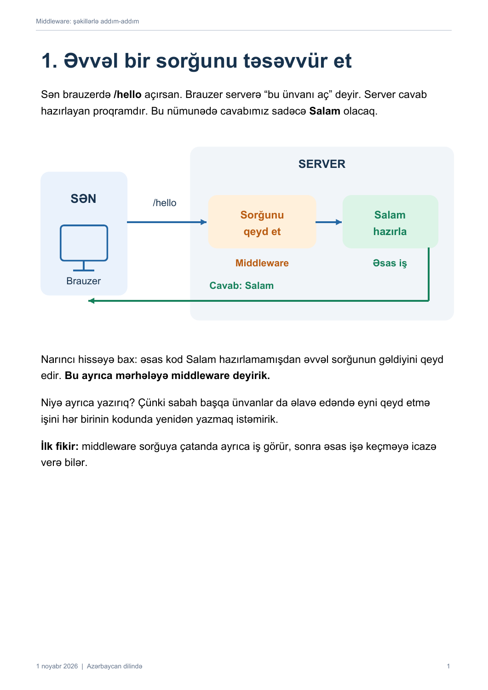
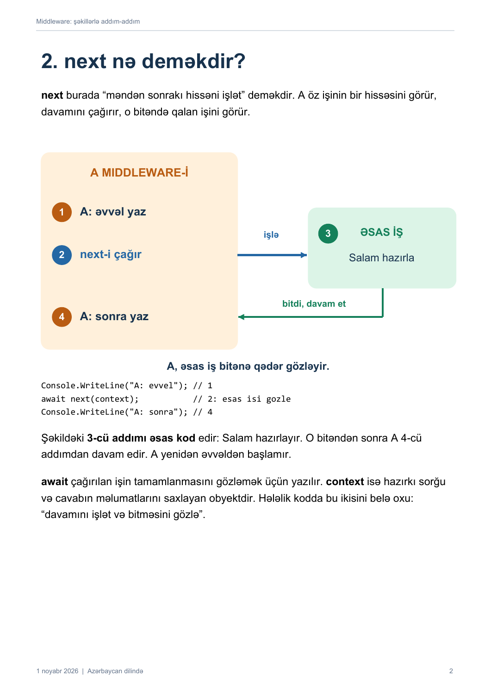
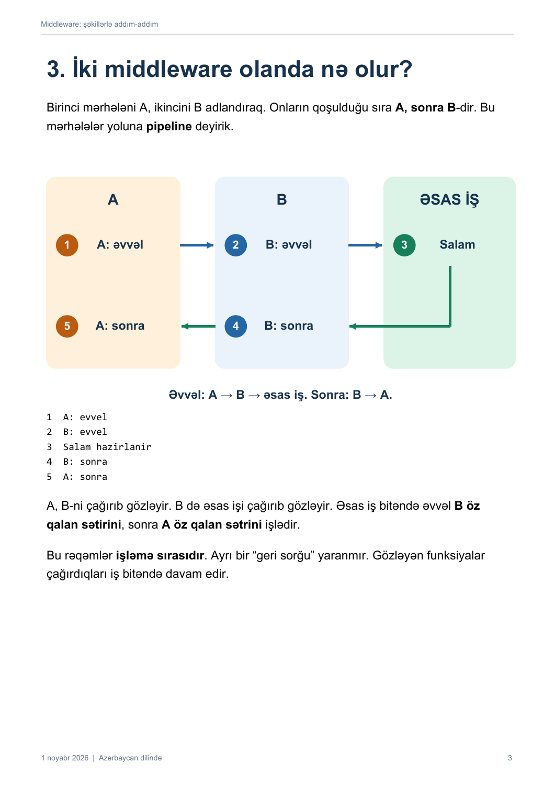
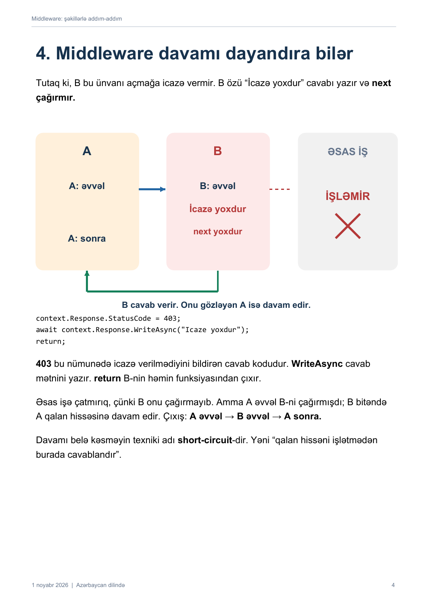

# Middleware: şəkillərlə addım-addım

Əvvəl bir sorğunu, sonra bir middleware-i, next-i və iki middleware-in işləmə sırasını şəkillərlə izah edirik.
Tam izah: [Middleware.pdf](Middleware.pdf).

## Sorğunun yolu


## next nə edir?


## İki middleware-in sırası


## Davam dayandırılanda


## Tam başlanğıc kodu
```csharp
var builder = WebApplication.CreateBuilder(args);
var app = builder.Build();

app.Use(async (context, next) =>
{
    Console.WriteLine("A: evvel");
    await next(context);
    Console.WriteLine("A: sonra");
});

app.MapGet("/hello", () =>
{
    Console.WriteLine("Salam hazirlanir");
    return "Salam";
});

app.Run();
```

Müsahibə sualları PDF-in son səhifəsindədir.
Mənbələr: [ASP.NET Core middleware](https://learn.microsoft.com/en-us/aspnet/core/fundamentals/middleware/), [middleware və DI](https://learn.microsoft.com/en-us/aspnet/core/fundamentals/middleware/write), [IMiddleware](https://learn.microsoft.com/en-us/aspnet/core/fundamentals/middleware/extensibility).
